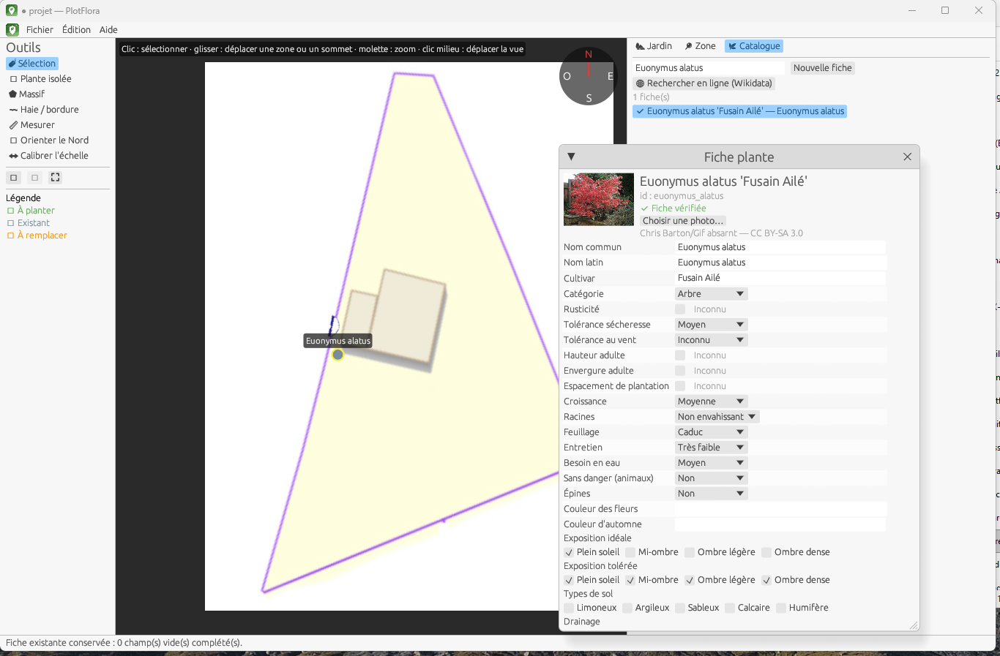
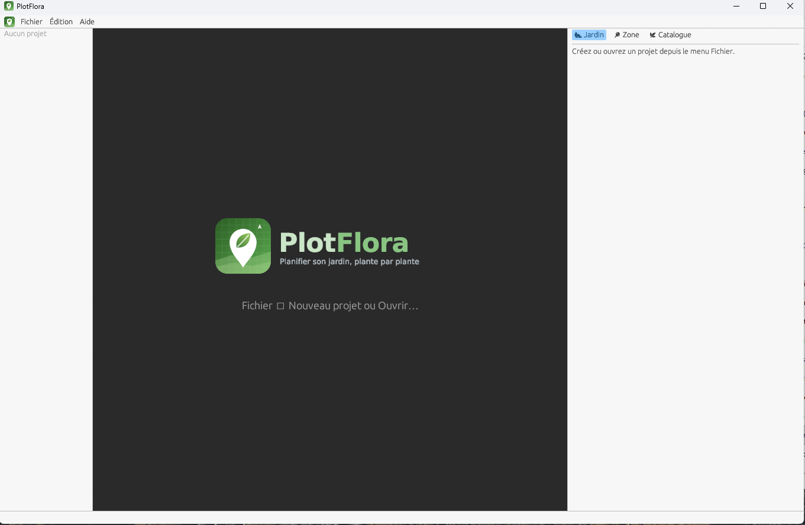

<p align="center"></p>

# PlotFlora 1.1

PlotFlora est un logiciel libre et local pour planifier son jardin. Sur une vue aérienne IGN ou un plan dessiné, placez plantes isolées, massifs et haies, décrivez soleil, sol et climat : un algorithme explicable classe sur 100 points les plantes les mieux adaptées et calcule les quantités à planter.

<p align="center">
  
</p>

<p align="center">
  
</p>

Spécification : `plotflora_specifications_v1.1.md`.

## Structure

| Crate | Rôle |
| :--- | :--- |
| `plotflora-core` | Vocabulaire, modèle, géométrie, recherche floue, conversions, scoring. Aucune I/O, aucune dépendance obligatoire (`serde` en option). |
| `plotflora-data` | JSON atomique, catalogue (embarqué + utilisateur), cache, index EIVE, Wikidata / Wikipédia / Commons. |
| `plotflora-app` | Interface egui/eframe (binaire `plotflora`). |
| `plotflora-catalog-builder` | Outil développeur : génère `assets/eive_index.json` et complète `assets/plants_catalog.seed.json`. |

## Compiler et lancer

```sh
cargo test --workspace
cargo run --release -p plotflora-app
```

Pour respecter les règles d'usage de Wikimedia, indiquez un contact (URL ou e-mail) à la compilation :

```powershell
$env:PLOTFLORA_CONTACT = "https://github.com/votre-compte/plotflora"; cargo build --release -p plotflora-app
```

Données utilisateur : `%APPDATA%\PlotFlora\` (`plants_catalog.json`, `photos\`, `lookup_cache.json`).

## Générer le catalogue embarqué (`plotflora-catalog-builder`)

Outil **réservé au développeur**, à ne pas distribuer aux utilisateurs. On le lance avant de compiler
une version de PlotFlora pour préparer les deux fichiers de données intégrés au binaire :
`assets/eive_index.json` (exposition, humidité et pH, à partir du classeur EIVE) et
`assets/plants_catalog.seed.json` (fiches de départ complétées via Wikidata et Wikipédia).


1. Télécharger le classeur EIVE (Tichý et al. 2023, CC BY 4.0) : <https://doi.org/10.5281/zenodo.7427088>.
2. Lancer :

```sh
cargo run -p plotflora-catalog-builder -- --eive Indicator.values-tables-2022-11-07-Zenodo.v2.xlsx \
    --species assets/seed_species.txt --out assets
```

Si une colonne n'est pas trouvée, l'outil affiche les en-têtes disponibles : précisez-les avec
`--sheet`, `--taxon-col`, `--l-col`, `--m-col`, `--r-col`. Vérifiez les échelles (lumière 1–9,
humidité 1–12, réaction 1–9 attendues ; voir `plotflora-core/src/convert.rs`). Recompilez ensuite
l'application : les deux fichiers sont intégrés au binaire.

## Raccourcis

`Ctrl+S` enregistrer · `Ctrl+Z` / `Ctrl+Y` annuler / rétablir · `Suppr` supprimer la zone ·
`Entrée` ou double-clic : terminer un tracé · `Retour arrière` : retirer le dernier point · `Échap` : abandonner ·
molette : zoom · clic milieu : déplacer la vue.

## Licence

Copyright © 2026 ChatCarbo. Code sous licence **GNU GPL v3 ou ultérieure** (`LICENSE`).
Les données de tiers gardent leurs propres licences : voir `NOTICE.md`.
